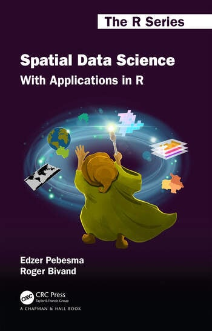
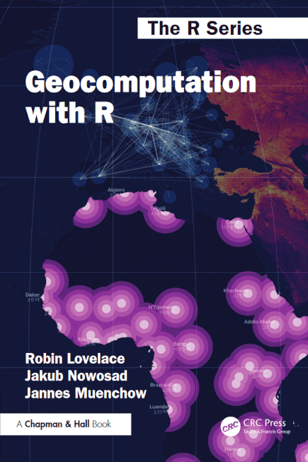
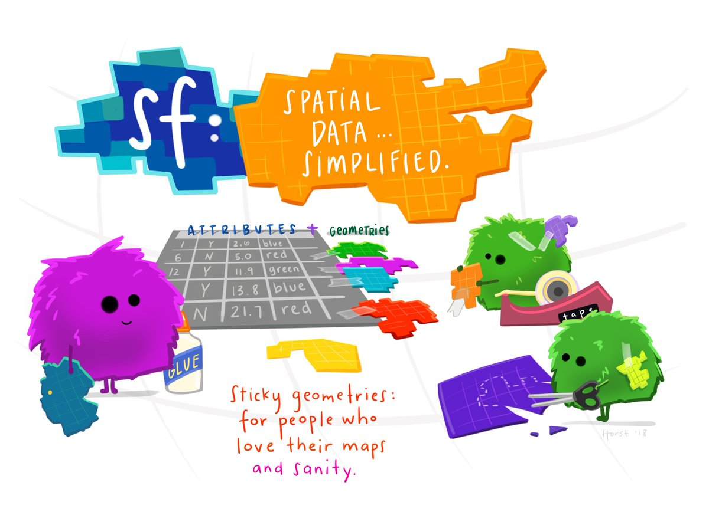

{width="32%"}

En este tema vamos a trabajar con datos vectoriales con el paquete **sf**:


Para más información visita la web <https://r-spatial.github.io/sf/>, en la que nos hemos centrado para preparar el material.

Libros de referencia:

<https://r-spatial.org/book/>



<https://r.geocompx.org/>

{width="365"}

**sf** viene de *"**simple features**",* una forma sencilla de trabajar con datos espaciales, ya que no es más que un *data frame* (i.e. los atributos), con la información geométrica (i.e. información espacial incluyendo el sistema de proyección).

## Simple features o "entidades simples" y su implementación en R

*"Simple features"* se refiere a un estandar formal (ISO 19125-1:2004) que describe cómo objetos del mundo real pueden representarse en los ordenadores, con énfasis a la geometría espacial de estos objetos. También incluye cómo pueden guardarse y almacenarse los objetos, así como las operaciones geométricas que pueden hacerse con ellos.

Las entidades o "*features*" a las que se refiere el [paquete **`sf`**](https://journal.r-project.org/articles/RJ-2018-009/index.html) pueden ser consideradas como cosas u objetos que tienen una determinada localización espacial o extensión (es decir, su **geometría**), que pueden ser descrita por puntos, lineas, poligonos o combinaciones de estos. El *simple* se refiere a que las líneas o polígonos están construidos por puntos que se conectan por lineas rectas. Además, cada elemento tiene una serie de ***atributos*** o propiedades, que son características o variables que se añaden a cada unidad de observación. Este paquete está estandarizado en el formato `tidyverse`, y se usa comunmente con paquetes como **`dplyr`** o **`ggplot2`**, que hemos usado en el curso.

Una *entidad simple* se define en la especificación abstracta de OpenGIS como un elemento que tiene **atributos espaciales** y **no espaciales**. Los atributos espaciales son de tipo **geometría**, y los **no espaciales** se basan en geometrías 2D con interpolación lineal entre vértices.

{width="600"}

En R los objetos espaciales son simplemente objetos y todas las funciones espaciales se inician con "*st\_"* que se refiere a un "*spatial type*" o "*tipo espacial*" y hace que la forma de completar el código sea sencillo. La gestión de datos espaciales requiere la lectura de datos espaciales, la manipilación y escritura de los resultados.

En primer lugar, podríamos leer unos datos:

```{r}
library(tidyverse)
library(sf)

nc <- st_read(system.file("shape/nc.shp", package = "sf"))

class(nc)

print(nc, n = 3)
```

Normalmente, los usuarios no usan la función *"system file"* sino que propocionan directamente un nombre de archivo. Al ver el tipo de objeto, se puede ver como es un "data.frame" con una columna tipo lista con la geometría.

Cuando imprimimos la base de datos, vemos cada columna es cada atributo dentro de la geometría. Podríamos crear un objeto tipo data.frame a partir del objetio tipo `sf`, pero en ese caso pierde la columa de geometría (que es tipo lista), no podemos hacer un gráfico y no podemos hacer todos los métodos de análisis espacial que se pueden hacer con un objeto tipo `sf`.

```{r}
nc.no_sf <- as.data.frame(nc)
class(nc.no_sf)
```

Para ver todas las funciones que se pueden usar con formato `sf`, podemos verlo de la siguiente manera:

```{r}
methods(class = "sf")
```

## Coordenadas

::: callout-tip
*Data are not just numbers, they are numbers with a context; in data analysis, context provides meaning* ([Cobb and Moore 1997](https://r-spatial.org/book/references.html#ref-cobbmoore))
:::

Para información espacial, la localización se caracteriza mediante **coordenadas** y estas coordenadas se definen mediante un sistema espacial. La mayor diferencia es si las coordenadas son cartesianas (es decir, definidas en un espacio de dos o tres dimensiones respecto a ejes ortogonales) o polar, esférico o elipsoidal (es decir, usando las distancias o direcciones).

Además, las coordenadas generalmente tienen dos dimensiones X e Y (longitud y latitud), pero podrían tener una tercera Z (altitud) e incluso una cuarta M que es raramente usada pero que se refiere a alguna medida asociada con el punto (no con la entidad, ya que sino sería un atributo).

Con esta información, los tipos de geometría son:

| **Tipo** | **Descripción** |
|---------------------------------------|------------------------------------------------------------------------------------|
| **POINT** | Geometría de dimensión cero que contiene un único punto. |
| **LINESTRING** | Secuencia de puntos conectados por segmentos de línea rectos que no se intersectan a sí mismos; geometría unidimensional. |
| **POLYGON** | Geometría con un área positiva (bidimensional); una secuencia de puntos forma un anillo cerrado que no se intersecta a sí mismo. El primer anillo es el exterior; los anillos siguientes (cero o más) representan agujeros. |
| **MULTIPOINT** | Conjunto de puntos; un MULTIPOINT es simple si no hay dos puntos iguales dentro del conjunto. |
| **MULTILINESTRING** | Conjunto de líneas (linestrings). |
| **MULTIPOLYGON** | Conjunto de polígonos. |
| **GEOMETRYCOLLECTION** | Conjunto de geometrías de cualquier tipo, excepto otra GEOMETRYCOLLECTION. |

Las coordenadas solo pueden ubicarse en la superficie de la Tierra cuando se conoce su **sistema de referencia de coordenadas (CRS)**; este puede ser un CRS esferoidal como WGS84, un CRS proyectado y bidimensional (cartesiano) como una zona UTM o Web Mercator, o un CRS tridimensional o que incluya el tiempo.

En un objeto tipo `sf` la columna de tipo lista, es de clase `sf` y se puede obtener con la función `st_geometry()`:

```{r}
nc_geom <- st_geometry(nc) #seleccionamos las geometrias
nc_geom[[1]] #para ver una geometría completa seleccionando el primero.
```

```{r}
par(mar = c(0,0,1,0))

plot(nc[1], reset = FALSE) # reset = FALSE: queremos añadir un plot con una leyenda
plot(nc[1,1], col = 'grey', add = TRUE)
```

Las transformaciones en el código se realizan con la función `st_transform()`. Por ejemplo se pueden transformar las coordenadas de NAD27 a WGS84.

```{r}
nc_wgs84 <- st_transform(nc, 4326)   # o "EPSG:4326"
nc_wgs84
```

## Lectura y escritura de sf en archivos externos

Como hemos visto más arriba se pueden leer datos espaciales usando archivos con extensión ".shp", usando la función `st_read()`. Podríamos guardar el archivo de la misma manera, usando la función `st_write()`.

```{r}
 
filename <- system.file("shape/nc.shp", package = "sf")
  
nc <- st_read(filename)  

st_write(nc, "nc_result.shp", delete_layer=TRUE)  
```

En documentación [GDAL](https://gdal.org/en/latest/drivers/vector/index.html)"*Geospatial Data Abstraction Library*" para el almacenamiento persistente se deben usar las funciones [CRUD](https://en.wikipedia.org/wiki/Create,_read,_update_and_delete) (*create*, *read*, *update* y *delete*, de crear, leer, actualizar y eliminar). En `st_write()`tienes los siguientes argumentos: `update = TRUE`, `delete_layer = TRUE`.

## Algunos ejemplos de operaciones geométricas

Para **validar y ver la simplicidad de las geometrías**, podemos usar lo siguiente:

- **`st_is_valid()`** → evalúa si una geometría es válida topológicamente
- **`st_is_simple()`** → revisa si no tiene autointersecciones ni complejidades internas

```{r}
st_is_valid(nc[1:2,])
st_is_simple(nc[1:2,])
```

Estas funciones ayudan a detectar geometrías corruptas o inesperadas antes de operaciones más complejas.

Para analizar **distancias y relaciones espaciales** entre las geometrías, existe `st_distance()` que calcula la distancia entre todas las parejas de geometrías.

```{r}
st_distance(nc[c(1,4,22),], nc[c(1,33,55,56),])
```

Las funciones como:

- `st_intersects()`
- `st_disjoint()`
- `st_touches()`
- `st_within()`
- `st_contains()`
- `st_overlaps()`

permiten comprobar relaciones entre geometrías.

Podemos mostrar los pares que cumplen la relación:

```{r}
st_intersects(nc[1:5,], nc[1:4,])
```

```{r}
st_intersects(nc[1:5,], nc[1:4,], sparse = FALSE)
```

Esto facilita interpretaciones booleanas con TRUE/FALSE.

Un **buffer** crea una zona a una distancia determinada de una geometría.

```{r}
sel <- c(1,5,14)

geom <- st_geometry(nc[sel,])

# Buffer de 0.3 grados (aprox ~30 km, pero NO exacto)
buf <- st_buffer(geom, dist = 0.3)

plot(buf, border = 'red')
plot(geom, add = TRUE)
plot(st_buffer(geom, 5000), add = TRUE, border = 'blue')
```

`st_union()` fusiona geometrías en una sola.

```{r}
par(mar = rep(0,4))
u <- st_union(nc)
plot(u)
```

En este ejemplo creamos manualmente dos polígonos y calculamos su intersección.

```{r}
opar <- par(mfrow = c(1, 2))

a <- st_polygon(list(cbind(
  c(0,0,7.5,7.5,0),
  c(0,-1,-1,0,0)
)))

b <- st_polygon(list(cbind(
  c(0,1,2,3,4,5,6,7,7,0),
  c(1,0,.5,0,0,0.5,-0.5,-0.5,1,1)
)))

plot(a, ylim = c(-1,1))
title("Intersección de dos polígonos")
plot(b, add = TRUE, border = 'red')

i <- st_intersection(a,b)
i
```

La intersección puede resultar en una **GEOMETRYCOLLECTION**, como en este caso:

- Un polígono
- Una línea
- Un punto

```{r}
plot(a, ylim = c(-1,1))
title("Resultado: GEOMETRYCOLLECTION")
plot(b, add = TRUE, border = 'red')
plot(i, add = TRUE, col = 'green', lwd = 2)

par(opar)
```

## Ejercicios

### **Exploración del objeto espacial y sus geometrías**

**Objetivo:** comprender la estructura interna de objetos *sf* y visualizar geometrías.

Usando el objeto `nc` cargado en el documento:

1.  Extrae únicamente la columna geométrica con `st_geometry()`.

2.  Selecciona la geometría del condado Camden e imprime sus primeras 10 coordenadas, identifica si es `POLYGON` o `MULTIPOLYGON`.

3.  Representa en un gráfico el conjunto completo de `nc` en gris claro, y la geometría seleccionada en rojo, encima.

    **Pista:** usa `plot(nc["NAME"])` y luego `add = TRUE`.

### **Transformaciones de CRS y distancias reales**

**Objetivo:** entender el efecto del CRS en cálculos métricos.

1.  Transforma el objeto `nc` a WGS84 (EPSG:4326) y a Web Mercator (EPSG:3857).

2.  Selecciona dos geometrías (por ejemplo, condados número 10 y 20).

3.  Calcula la distancia entre ambos en WGS84 y Web Mercator. Explica por qué las distancias son tan diferentes en ambos sistemas.

4.  Representa gráficamente las dos geometrías en 3857 y dibuja un buffer de 20 km alrededor del condado 10.

    **Pista:** en 3857 el buffer es en metros.

### **Relaciones espaciales (intersecciones y vecinos)**

**Objetivo:** trabajar con *predicados espaciales* (`st_intersects`, `st_touches`, etc.).

1.  Usando `nc`, crea un vector con los índices de los condados que intersectan con el condado número 5.

2.  Crea otro vector para los que solo tocan (comparten borde, no área).

3.  Representa en un mapa el condado 5 en azul, los que intersectan en verde, los que solo tocan en amarillo y el resto en gris.

4.  Explica por qué algunos condados aparecen como intersectando y otros como tocando según la topología.

    **Pista:** usa `st_intersects(nc[5,], nc) st_touches(nc[5,], nc)`

### **Operaciones geométricas y GEOMETRYCOLLECTION**

**Objetivo:** comprender resultados complejos de operaciones espaciales.

Usando el ejemplo de polígonos `a` y `b` del final del material:

1.  Reproduce el cálculo `st_intersection(a, b)`.

2.  Identifica qué tipos de geometrías contiene el resultado (`POINT`, `LINESTRING` y/o `POLYGON`).

3.  Extrae por separado el polígono, la línea y el punto.

4.  Representa cada uno en un mapa distinto, destacando su geometría.

5.  Explica con tus palabras por qué la intersección puede generar un **GEOMETRYCOLLECTION**.

**Pista:** usa `st_collection_extract(obj, "POLYGON")`, etc.

## Cita del paquete sf

- Pebesma, E. 2018. Simple Features for R: Standardized Support for Spatial Vector Data. The R Journal [10:1, 439-446.](https://journal.r-project.org/archive/2018/RJ-2018-009/index.html)
